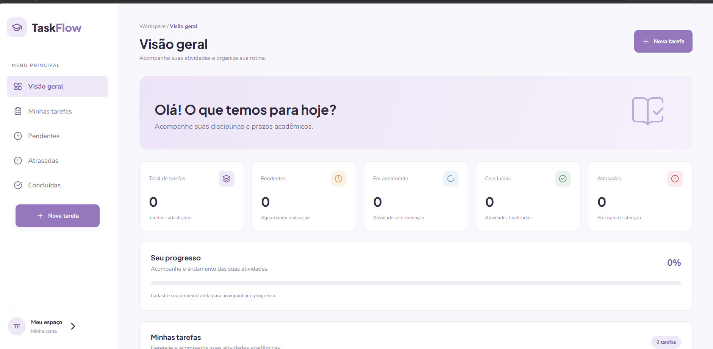
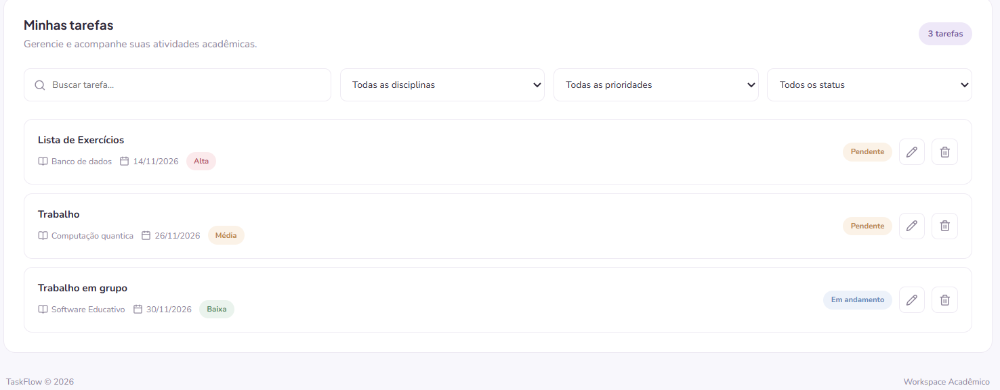
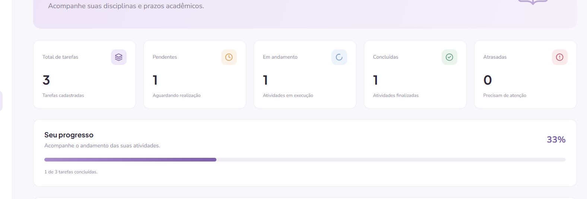
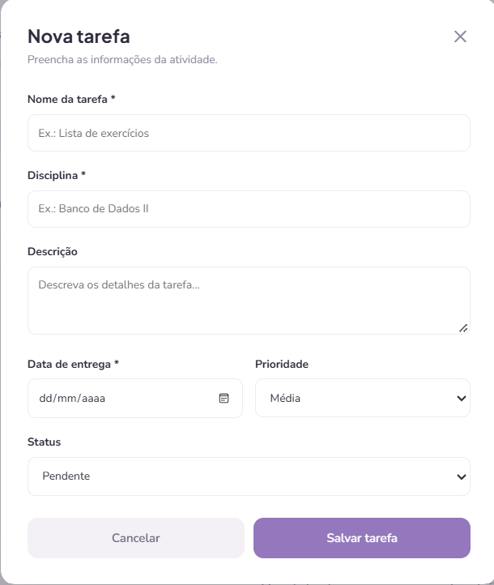
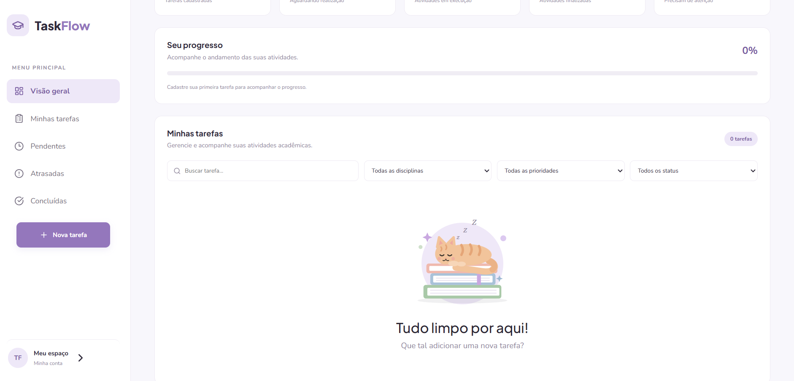
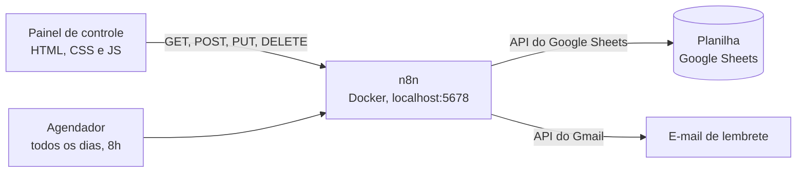

# TaskFlow

Dashboard de tarefas acadêmicas integrado ao **n8n**, com **Google Sheets** como banco de dados e lembretes automáticos por e-mail.

Este é um **projeto de estudo**, criado para praticar automação com n8n. Toda a stack roda localmente: o n8n em um container Docker e o acesso ao Google Sheets e ao Gmail via APIs configuradas no Google Cloud.



## Funcionalidades

- Cadastro, edição e exclusão de tarefas por meio de um modal
- Indicadores de total, pendentes, em andamento, concluídas e atrasadas
- Barra de progresso com o percentual de tarefas concluídas
- Busca por texto e filtros por disciplina, prioridade e status
- Estado vazio com ilustração quando nenhuma tarefa corresponde aos filtros
- Atalhos no menu lateral para filtrar por status
- Lembrete diário por e-mail para tarefas com entrega hoje ou amanhã
- Tela "Meu espaço" apenas demonstrativa (sem login)

## Telas

**Lista de tarefas, com busca e filtros**



**Indicadores e progresso**



**Cadastro de tarefa**



**Estado vazio**



## Como funciona

O dashboard é uma página estática (HTML, CSS e JavaScript puro) que conversa com o n8n por requisições HTTP. Cada operação chega a um webhook do n8n, que lê ou grava na planilha através da API do Google Sheets.



## Tecnologias

- **Front-end:** HTML, CSS e JavaScript puro, com [Lucide](https://lucide.dev) para ícones e Google Fonts para a tipografia
- **Automação:** n8n (self-hosted)
- **Infraestrutura local:** Docker
- **Dados:** Google Sheets
- **APIs e autenticação:** Google Cloud (Google Sheets API, Gmail API e OAuth 2.0)

## Estrutura do repositório


taskflow/
├── dashboard/
│   ├── index.html
│   ├── script.js
│   └── style.css
├── n8n-workflows/
│   ├── 01-cadastro-formulario.json
│   ├── 02-atualizacao-formulario.json
│   ├── 03-lembretes-automaticos.json
│   ├── 04-listagem-tarefas.json
│   ├── 05-exclusao-tarefas.json
│   ├── 06-cadastro-tarefas-api.json
│   └── 07-atualizacao-tarefas-api.json
├── docs/img/
└── README.md
```

## Workflows do n8n

| Arquivo | Gatilho | Função |
| --- | --- | --- |
| `01-cadastro-formulario` | Formulário do n8n | Versão inicial do cadastro, antes do dashboard |
| `02-atualizacao-formulario` | Formulário do n8n | Versão inicial da atualização, antes do dashboard |
| `03-lembretes-automaticos` | Agendamento (8h) | Envia e-mail das tarefas que vencem hoje ou amanhã |
| `04-listagem-tarefas` | Webhook `GET` | Retorna todas as tarefas da planilha |
| `05-exclusao-tarefas` | Webhook `DELETE` | Remove a tarefa pelo ID |
| `06-cadastro-tarefas-api` | Webhook `POST` | Cadastra uma nova tarefa |
| `07-atualizacao-tarefas-api` | Webhook `PUT` | Atualiza uma tarefa existente pelo ID |

Os workflows 01 e 02 foram mantidos como registro da primeira versão e são substituídos pelos 06 e 07. Para usar o dashboard, apenas **03 a 07** precisam estar ativos.

## API

Os quatro webhooks compartilham o mesmo caminho e se diferenciam pelo método HTTP:

```
http://localhost:5678/webhook/taskflow/tarefas
```

| Método | Parâmetros | Resposta |
| --- | --- | --- |
| `GET` | nenhum | Lista com as linhas da planilha |
| `POST` | corpo JSON (abaixo) | `{ "sucesso": true, "mensagem": "..." }` |
| `PUT` | corpo JSON (abaixo), localizado pelo `id` | `{ "sucesso": true, "mensagem": "..." }` |
| `DELETE` | query string `?id=TF-XXXX` | `{ "sucesso": true, "mensagem": "..." }` |

Corpo do `POST` e do `PUT`:

```json
{
  "id": "TF-MHX2K9",
  "tarefa": "Lista de exercícios",
  "disciplina": "Banco de Dados II",
  "descricao": "Questões 1 a 10",
  "data": "2026-11-20",
  "prioridade": "Alta",
  "status": "Pendente"
}
```

O `id` é gerado pelo próprio dashboard (prefixo `TF-` seguido de um valor baseado no horário).

## Estrutura da planilha

Crie uma planilha no Google Sheets com uma aba chamada **Tarefas** e, na primeira linha, os cabeçalhos abaixo (exatamente com estes nomes):

| ID | Tarefa | Disciplina | Descrição | Data de Entrega | Prioridade | Status |
| --- | --- | --- | --- | --- | --- | --- |

- `Data de Entrega` deve estar no formato `AAAA-MM-DD`. Recomenda-se formatar essa coluna como **Texto simples** para o Google Sheets não converter as datas.
- `Prioridade`: `Alta`, `Média` ou `Baixa`.
- `Status`: `Pendente`, `Em andamento` ou `Concluída`. O status **Atrasada** não é gravado na planilha: o dashboard o calcula comparando a data de entrega com a data atual.

## Como executar

### Pré-requisitos

- [Docker](https://www.docker.com/products/docker-desktop/) instalado
- Conta Google
- Navegador atual

### 1. Clonar o repositório

```bash
git clone https://github.com/Giovana-Fortunato/taskflow-n8n-dashboard.git
cd taskflow-n8n-dashboard
```

### 2. Subir o n8n com Docker

```bash
docker volume create n8n_data

docker run -d --name n8n \
  -p 5678:5678 \
  -e GENERIC_TIMEZONE=America/Sao_Paulo \
  -e TZ=America/Sao_Paulo \
  -v n8n_data:/home/node/.n8n \
  docker.n8n.io/n8nio/n8n
```

No PowerShell, escreva o comando em uma única linha ou troque `\` por `` ` ``.

O volume `n8n_data` guarda workflows e credenciais, que continuam existindo se o container for removido. A variável de fuso horário garante que o agendamento das 8h use o horário de Brasília.

Acesse `http://localhost:5678` e crie a conta local do n8n. Para pausar e retomar o container:

```bash
docker stop n8n
docker start n8n
```

### 3. Configurar o Google Cloud

O n8n acessa a planilha e o Gmail por OAuth 2.0, então é preciso criar as credenciais no [Google Cloud Console](https://console.cloud.google.com).

1. **Criar um projeto** (por exemplo, `taskflow`).
2. **Ativar as APIs** em *APIs e serviços > Biblioteca*: **Google Sheets API** e **Gmail API**.
3. **Configurar a tela de consentimento OAuth**: tipo de usuário *Externo* e, enquanto o app estiver em modo de teste, adicionar o seu e-mail como **usuário de teste**.
4. **Criar o ID do cliente OAuth** em *APIs e serviços > Credenciais*, com tipo de aplicativo **Aplicativo da Web**. Em *URIs de redirecionamento autorizados*, adicione:

   ```
   http://localhost:5678/rest/oauth2-credential/callback
   ```

   Esse valor é exibido na própria tela de credencial do n8n; copie-o de lá para garantir que fique idêntico, incluindo protocolo e porta.
5. Anote o **Client ID** e o **Client Secret**.

Como o n8n roda localmente, não é necessário domínio público nem HTTPS.

### 4. Criar as credenciais no n8n

No n8n, vá em *Credentials > Create credential* e crie duas credenciais, informando o Client ID e o Client Secret do passo anterior:

- **Google Sheets OAuth2 API**
- **Gmail OAuth2 API**

Em cada uma, clique em **Sign in with Google** e autorize o acesso. Como o app está em modo de teste, o Google exibe o aviso "app não verificado"; é possível prosseguir em *Avançado*.

### 5. Importar e configurar os workflows

1. No n8n, use *Workflows > Import from file* e importe os arquivos de `n8n-workflows/` (no mínimo do 03 ao 07).
2. Em **cada nó do Google Sheets**, selecione a credencial criada, a sua planilha e a aba **Tarefas**. Os arquivos exportados têm o marcador `SEU_ID_DA_PLANILHA` no lugar do ID real.
3. No workflow **03**, abra o nó do Gmail, selecione a credencial e troque `SEU_EMAIL@exemplo.com` pelo e-mail que deve receber os lembretes.
4. **Ative** os workflows 03 a 07 (*Active* ou *Publish*, conforme a versão do n8n). Os webhooks de produção só respondem em `/webhook/...` com o workflow ativo.

Para testar a listagem, abra no navegador `http://localhost:5678/webhook/taskflow/tarefas`; deve aparecer um JSON com as linhas da planilha.

### 6. Abrir o dashboard

Abra `dashboard/index.html` direto no navegador ou sirva a pasta com um servidor local:

```bash
cd dashboard
python3 -m http.server 8080
```

e acesse `http://localhost:8080`.

O endereço do n8n está definido no início de `dashboard/script.js`:

```js
const API_URL = "http://localhost:5678/webhook/taskflow/tarefas";
```

Altere esse valor se o n8n estiver em outro host ou porta.

## Lembretes por e-mail

O workflow 03 roda todos os dias às 8h (fuso `America/Sao_Paulo`), lê a planilha e envia um e-mail para cada tarefa cuja data de entrega seja hoje ou amanhã e cujo status seja diferente de `Concluída`.

## Segurança

- Client ID, Client Secret e tokens ficam armazenados apenas no n8n (volume do Docker). Nada disso está no repositório.
- Os workflows foram exportados sem credenciais; o ID da planilha e o e-mail foram substituídos por marcadores.
- Nunca faça commit de exportações que incluam credenciais, arquivos `.env` ou o Client Secret.

## Limitações conhecidas

- Os webhooks **não têm autenticação**. O projeto foi pensado para uso local; não exponha o n8n na internet (por exemplo, com um túnel público) sem antes proteger os endpoints.
- Os lembretes só disparam se o computador e o container estiverem ligados às 8h.
- Com o app do Google Cloud em modo de teste, o token de acesso expira em cerca de 7 dias e a credencial precisa ser reconectada no n8n.
- A planilha funciona como banco de dados sem controle de concorrência, e a exclusão se baseia no número da linha.
- Não há login nem múltiplos usuários; a tela "Meu espaço" é demonstrativa.

## Conceitos praticados

- Webhooks no n8n com `Respond to Webhook` e múltiplos métodos HTTP no mesmo caminho
- Expressões do n8n para mapear o corpo e a query string das requisições
- Agendamento com `Schedule Trigger` e filtro condicional com o nó `If`
- Integração com Google Sheets e Gmail via OAuth 2.0 e Google Cloud
- Execução do n8n em Docker com volume persistente
- Consumo de uma API HTTP em JavaScript puro com `fetch`

## Possíveis melhorias

- Autenticação nos webhooks
- Substituir a planilha por um banco de dados
- Empacotar dashboard e n8n em um `docker-compose.yml`
- Login e tarefas por usuário

## Autora

Giovana · [@Giovana-Fortunato](https://github.com/Giovana-Fortunato)
